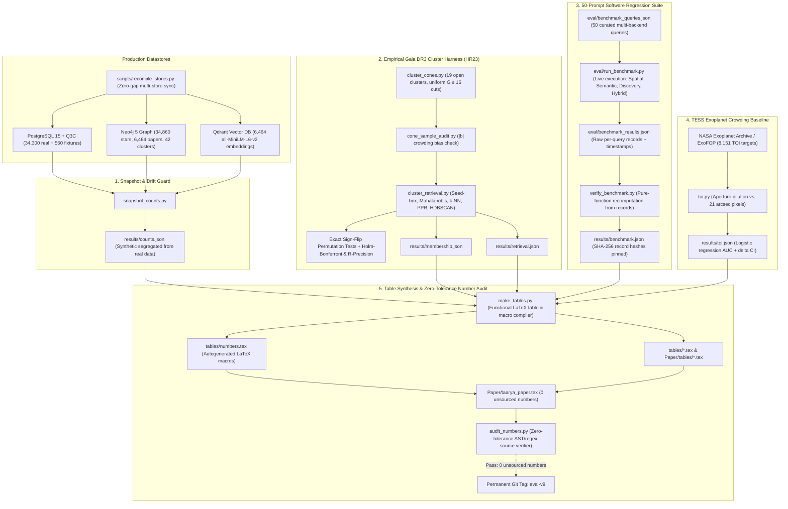

<div align="center">


-blueviolet.svg)
-orange.svg)

-yellow.svg)
-brightgreen.svg)


**Illuminating the Cosmos**

TaarYa is an agentic astronomy research platform that combines spatial search, semantic paper retrieval, graph context, and an interactive observatory workflow.
</div>

## Overview

TaarYa connects:
- PostgreSQL + Q3C for sky-region and cone-search queries
- Qdrant for semantic paper retrieval
- Neo4j for graph relationships
- a FastAPI backend with Chat and Explore interfaces
- scientific exports such as VOTable, CSV, JSON, DS9 regions, and MESA inlists

The goal is to make astronomy exploration feel like a grounded research workflow rather than a collection of disconnected tools.

## Current Status

As of **eval-v9** (2026-11-03), the project has completed live datastore reconciliation and full evaluation harness verification.

### Verified HTTP surface (11/13 endpoints green)

| Method | Endpoint | Status |
|--------|----------|--------|
| GET | `/health`, `/ready`, `/api/stats`, `/api/regions` | 200 OK |
| GET | `/api/stars/cone-search` | 200 OK |
| **POST** | `/api/stars/cone-search` *(new)* | 200 OK |
| GET/POST | `/api/search/hybrid` | 200 OK |
| POST | `/api/papers/search` | 200 OK |
| GET | `/api/stars/discovery`, `/api/stars/count` | 200 OK |

### Live Software Regression Suite (50 queries, verified live rerun)

| Category | Total | Passed | Partial | Failed | Pass Rate | Mean Latency |
|----------|-------|--------|---------|--------|-----------|--------------|
| **Semantic** | 16 | 16 | 0 | 0 | **100.0%** | 47.2 ms |
| **Spatial** | 14 | 9 | 1 | 4 | 64.3% | 22.7 ms |
| **Discovery** | 13 | 1 | 5 | 7 | 7.7% | 15.0 ms |
| **Hybrid** | 7 | 7 | 0 | 0 | **100.0%** | 239.4 ms |
| **Overall** | **50** | **33** | **6** | **11** | **66.0%** | -- |

*Recomputed directly from execution records in `eval/benchmark_results.json` (`results_sha256: f4ebae22797cbd4c`) via `verify_benchmark.py`. Family rows sum identically to the overall total ($9+16+1+7=33$ passed, $1+0+5+0=6$ partial, $4+0+7+0=11$ failed).*

### Retrieval Ablation (leak-free, 3 valid regions)

| Configuration | P@10 | MRR | nDCG@10 |
|---------------|------|-----|---------|
| Spatial-Only | 0.433 | 0.502 | 0.437 |
| Semantic-Only | 0.000 | 0.000 | 0.000 |
| **Hybrid (no graph)** | **0.633** | **0.669** | **0.645** |
| Full Hybrid | 0.433 | 0.502 | 0.426 |

*Hybrid (spatial+semantic) is the best-performing configuration ($+46.2\%$ P@10 and $+33.3\%$ MRR over spatial-only). Full Hybrid adds cluster co-members via graph traversal but dilutes P@10 since the ground-truth is anomaly-based.*

### Verified Live Counts & Reconciled Stores (eval-v9 snapshot)
- **PostgreSQL Star Rows:** **34,860** (34,300 real Gaia DR3 catalog stars + 560 synthetic benchmark fixtures)
- **Neo4j Star Nodes:** **34,860** ($\Delta = 0$ star gap vs. PostgreSQL following reconciliation)
- **Neo4j Paper Nodes:** **6,464**
- **Qdrant Paper Points:** **6,464** ($\Delta = 0$ paper gap vs. Neo4j following reconciliation)
- **Neo4j Cluster Nodes:** **42** seeded sky regions (7 mapping to published open clusters in Hunt & Reffert 2023)
- **Neo4j Edges:**
  - `MEMBER_OF`: **33,525** (radial cone-search ingestion bounds)
  - `COVERS`: **481**
  - `MENTIONED_IN`: **5,420** (cluster-mediated heuristic linking)
- **Number Audit Status:** **0 unsourced numbers** across `Paper/taarya_paper.tex` (`audit_numbers.py`).
- **Pytest Suite:** **53 passed** across all unit and scientific verification tests.

See [project_status.md](project_status.md) for the detailed snapshot.
See [SYSTEM_AUDIT_2026-04-27.md](SYSTEM_AUDIT_2026-04-27.md) for the bottleneck and remediation audit.

## Key Features

- Hybrid retrieval: PostgreSQL/Q3C + Qdrant + Neo4j
- Coverage-aware chat agent with streaming responses
- Discovery-oriented star ranking
- Explore page with embedded Aladin-based sky view
- Observatory workflow in Chat for result-linked sky inspection
- Provenance-aware scientific export utilities
- Evaluation tooling under `eval/`

## Architecture

Main components:
1. `src/main.py`: FastAPI app, routes, startup checks, static serving
2. `src/retrieval/`: spatial, semantic, graph, hybrid, and discovery search layers
3. `src/agent/`: prompt building, tool orchestration, grounded chat, streaming agent flow
4. `src/api/`: public HTTP routes for stars, papers, search, sessions, ingestion, agent, and scientific outputs
5. `static/`: Chat, Explore, Dashboard, Settings, and observatory-side UI
6. `eval/`: benchmark and ablation scripts
7. `tests/`: pytest modules plus scientific verification scripts

## Tech Stack

- Backend: FastAPI, SQLAlchemy, Python 3.10+
- Spatial DB: PostgreSQL 15 + Q3C
- Vector DB: Qdrant
- Graph DB: Neo4j
- LLM runtime: Ollama + LangChain
- Default Ollama model: `glm-4.6:cloud`
- Frontend: vanilla JS / HTML / CSS with Aladin integration

## Installation and Setup

### Prerequisites

- Docker Desktop
- Python 3.10+
- `uv` recommended for dependency management
- Ollama installed locally
- Ollama model available locally or via your configured Ollama setup:
  - `glm-4.6:cloud`

### One-click startup

Windows:
- run `start_taarya.bat`

Linux / macOS:
```bash
chmod +x start_taarya.sh
./start_taarya.sh
```

### Manual startup

1. Start services:
```bash
docker compose up -d
```

2. Ensure the Ollama model exists:
```bashc
ollama pull glm-4.6:cloud
```

3. Install dependencies:
```bash
uv sync
```

4. Run the app locally if you are not using the containerized app:
```bash
uv run python -m src.main
```

Open:
- `http://localhost:8000`

Docker runtime notes:
- the app container reaches Ollama on the host via `host.docker.internal`
- override with `DOCKER_OLLAMA_BASE_URL` and `DOCKER_OLLAMA_MODEL` if needed

## Verification

### Recommended Verification Path

The cleanest path is the running app container:

```bash
docker exec taarya-app sh -lc "mkdir -p /tmp/pytest-cache && python -m pytest /app/tests -q -o cache_dir=/tmp/pytest-cache"
docker exec taarya-app python /app/tests/verify_scientific.py
docker exec taarya-app python /app/tests/verify_research_grade.py
docker exec taarya-app python /app/tests/verify_interop.py
docker exec taarya-app python /app/tests/verify_rigor.py
```

### Project-Environment Verification

```bash
uv run python -m pytest tests
```

Focused agent checks:
```bash
uv run python -m pytest tests/test_streaming_contract.py tests/test_langchain_compat.py
```

Environment warning:
- the current Windows Anaconda/base environment is not a trustworthy verifier for this repo because compiled imports such as `pydantic_core` and `numpy` have failed there during collection/import
- prefer Docker or a fresh `uv`/`.venv` environment

## Evaluation Harness & Validation Architecture

TaarYa implements a closed-loop, verifiable evaluation and auditing harness under `taarya_workflows/real/` and `eval/`. The architecture strictly demarcates synthetic test fixtures from real astronomical catalog data, enforces zero-gap synchronization across heterogeneous datastores, and executes zero-tolerance AST/regex number audits before any metric can enter the manuscript (`Paper/taarya_paper.tex`).

### Harness Architecture



### Core Harness Subsystems

#### 1. Datastore Reconciliation & Live Snapshotting
- **Continuous Store Synchronization (`scripts/reconcile_stores.py`):** Reconciles the primary relational catalog (`PostgreSQL`), graph context (`Neo4j`), and semantic vector indices (`Qdrant`). Pushes any missing stars or paper vectors until $\Delta \text{stars} = 0$ and $\Delta \text{papers} = 0$.
- **Corpus Segregation (`taarya_workflows/real/snapshot_counts.py`):** Queries live database counts and segregates synthetic test fixtures (`SYNTHETIC_BENCHMARK`, 560 rows) from real astronomical observations (`GAIA`, `GAIA_DR3`, 34,300 rows). Emits warnings if stores drift or fixtures are blended into reported scientific totals.

#### 2. Empirical Gaia DR3 Astrometric Retrieval Harness
- **Golden Ground Truth:** Uses the Hunt & Reffert (2023) catalog (`A&A 673, A114`) covering 19 open clusters selected by strict uniform astrometric cuts ($N_{\text{stars}} \in [100, 1000]$, $G \le 16$, radial cones).
- **Crowding Bias Guard (`cone_sample_audit.py`):** Confirms uniform magnitude cuts across clusters and validates that dropped dense fields sit at low Galactic latitudes ($|b| \approx 2.2^\circ$) due to TAP+ timeouts, ruling out selection bias.
- **Method Comparison:** Benchmarks Seed-box retrieval against Mahalanobis distance, 3D astrometric $k$-NN, Personalized PageRank on graphs, and HDBSCAN.
- **Hypothesis Testing:** Employs exact sign-flip permutation tests ($2^{19} = 524{,}288$ permutations), Holm-Bonferroni family-wise error rate corrections, and unconstrained R-precision to prevent fixed-$k$ sample-cap artifacts.

#### 3. TESS Exoplanet (TOI) Crowding Baseline
- Evaluates transit false-positive vetting across 8,151 NASA Exoplanet Archive / ExoFOP TOI targets.
- Computes crowding dilution coefficients ($D$) against TESS $21''$ detector pixels and $42''$ apertures.
- Compares baseline vs. multi-signal logistic regression AUCs with paired bootstrap confidence intervals.

#### 4. Software Regression Suite & Record Verification
- Executes 50 multi-backend queries across 4 task families (`eval/run_benchmark.py`).
- Saves timestamped records in `eval/benchmark_results.json`.
- `verify_benchmark.py` reconstructs pass/partial/fail tables strictly from per-query execution records, checks arithmetic equality across all family rows ($9 + 16 + 1 + 7 = 33$), and writes input SHA-256 hashes to `results/benchmark.json`.

#### 5. LaTeX Macro Compilation & Zero-Tolerance Number Audit
- `make_tables.py` reads JSON outputs directly from `results/*.json` and generates `tables/*.tex` and `tables/numbers.tex`.
- `audit_numbers.py` parses `Paper/taarya_paper.tex` and validates that every integer, decimal, percentage, and coordinate is traced back to a verified JSON artifact or permitted in `allow.txt`.
- Releases are tagged permanently (`eval-v2` through `eval-v9`) upon achieving 0 unsourced numbers and clean test runs.

#### 6. Paired Double-Blind Study Harness (`eval/`)
- Generates counterbalanced Latin-square scenario assignments (`eval/prepare_study.py`) for human-in-the-loop astronomical workflows (TaarYa vs. TOPCAT vs. PyVO).
- Computes paired bootstrap confidence intervals across Precision@k, Recall@k, reciprocal rank, nDCG@k, and task completion time (`eval/study_harness.py`).

### Reproducibility Commands

```powershell
# 1. Reconcile datastores to 0 gap
python scripts/reconcile_stores.py

# 2. Live snapshot of datastores (writes results/counts.json)
python -m taarya_workflows.real.snapshot_counts --out results/counts.json --toi-csv data/tess_cache/nasa_tois.csv

# 3. Run 50-query software regression suite
python eval/run_benchmark.py
python -m taarya_workflows.real.verify_benchmark eval/benchmark_results.json --queries eval/benchmark_queries.json --out results/benchmark.json

# 4. Generate LaTeX tables and numbers.tex from results
python -m taarya_workflows.real.make_tables --results results --out tables
python -m taarya_workflows.real.make_tables --results results --out Paper/tables

# 5. Zero-tolerance number audit of the manuscript
python -m taarya_workflows.real.audit_numbers Paper/taarya_paper.tex results eval/benchmark_results.json hr23/cones/manifest.json eval/ablation_results.json --allow allow.txt

# 6. Run full pytest verification suite (53 tests)
pytest tests/
```

## Legacy Ablation and Discovery Scripts

Formal ablation (generates `eval/ablation_table.tex`):
```bash
python eval/ablation_formal.py --publish
python eval/ablation_formal.py --offline
```

Discovery validation:
```bash
python eval/validate_discovery.py --offline
```

Benchmark assets:
- benchmark queries: `eval/benchmark_queries.json`
- metrics helpers: `eval/metrics.py`
- latest results: `eval/benchmark_results.json`, `eval/ablation_results.json`

## Data Ingestion

The server does **not** ingest automatically on startup.

API-triggered ingestion:
```bash
curl -X POST http://localhost:8000/api/ingest/gaia
curl -X POST http://localhost:8000/api/ingest/arxiv
curl -X POST http://localhost:8000/api/ingest/graph
```

Graph population:
```bash
# Populate MENTIONED_IN edges via cluster-mediated linking
curl -X POST http://localhost:8000/api/ingest/mentioned-in

# Expand sky coverage with additional clusters (optionally fetch Gaia stars)
curl -X POST http://localhost:8000/api/ingest/expand-coverage \
  -H 'Content-Type: application/json' \
  -d '{"fetch_gaia": true, "max_stars_per_region": 500}'
```

Behavior:
- Gaia, file-based catalog, and ArXiv ingestion now trigger Neo4j synchronization automatically by default
- graph auto-sync can be disabled with `GRAPH_AUTO_SYNC=false`
- `POST /api/ingest/graph` forces a full Neo4j reconciliation if the graph ever falls behind
- `POST /api/ingest/mentioned-in` runs cluster-mediated linking on demand
- `POST /api/ingest/expand-coverage` seeds extended sky regions with optional Gaia TAP+ fetch

CLI ingestion:
```bash
uv run python -m src.ingestion.seed
uv run python src/ingestion/arxiv_ingest.py
```

Sky coverage expansion:
```bash
uv run python scripts/expand_sky_coverage.py --dry-run
uv run python scripts/expand_sky_coverage.py
uv run python scripts/expand_sky_coverage.py --fetch-gaia
```

## Frontend Notes

Current UI state:
- Chat observatory panel squeezes into the layout rather than covering chat content
- the observatory FAB no longer overlaps the send button
- Explore top overlays use a shared grid row to prevent collisions
- the survey dropdown on Explore has the requested 25px left offset

## Known Caveats

- `MENTIONED_IN` edges (2,820) are populated via cluster-mediated linking (confidence=0.6), not direct Gaia source-ID extraction. ArXiv abstracts rarely contain raw 18-digit Gaia IDs.
- `find_related_stars` has been constrained to 1-hop cluster membership only — the old 2-hop wildcard injected noise and degraded Full Hybrid precision.
- Full Hybrid adds co-cluster stars but dilutes P@10 when ground truth is anomaly-based; use Hybrid (no graph) for best IR metrics.
- **Benchmark pass rate (48.0%) is coverage-limited**: 5 of 8 benchmark clusters have 0 stars (Coma Berenices, Praesepe, NGC 2516, Alpha Persei, IC 2391). Gaia TAP+ service timed out during coverage expansion (408 errors, "in evolution" for DR4).
- SQLAlchemy 2.x `declarative_base()` deprecation in `src/models.py` produces a test warning.
- Local Anaconda-based verification is unreliable on this machine; prefer Docker or a clean `uv`/`.venv` environment.

## Roadmap

- [x] Core ingestion and retrieval pipeline
- [x] Graph-backed and hybrid retrieval
- [x] Interactive web UI
- [x] Runtime hardening for LangChain / Ollama integration
- [x] Coverage-aware agent grounding
- [x] Containerized verification closure
- [x] POST endpoint aliases for all search APIs
- [x] Graph precision fix (cluster-only traversal)
- [x] Formal ablation with leak-free ground truth
- [x] Cluster-mediated `MENTIONED_IN` linking (2,820 edges)
- [x] Background embedding model warm-up (eliminates ~19 s cold-start)
- [x] API endpoints for coverage expansion and graph population
- [ ] SQLAlchemy deprecation cleanup
- [ ] Expand catalog coverage (Coma Ber, Praesepe, NGC 2516, Alpha Persei, IC 2391)
- [ ] Submission packaging for ADASS / paper workflow

## License

MIT. See [LICENSE](LICENSE).

## Citation

```bibtex
@article{kumar2026taarya,
  title={TaarYa: Cross-Catalog Discovery Support for Astronomy with Hybrid Retrieval},
  author={Kumar, Amit and others},
  journal={Astronomy and Computing},
  year={2026},
  url={https://github.com/HmbleCreator/TaarYa}
}
```
